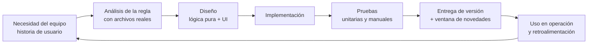
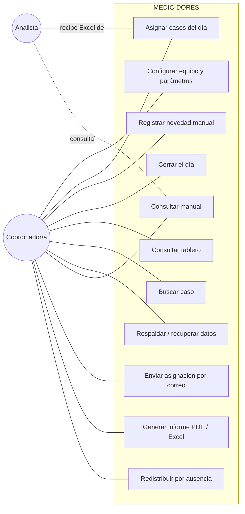
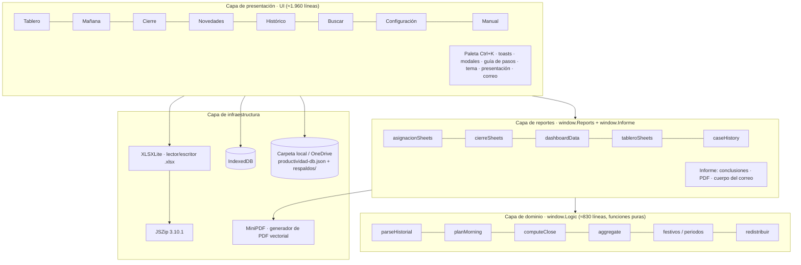
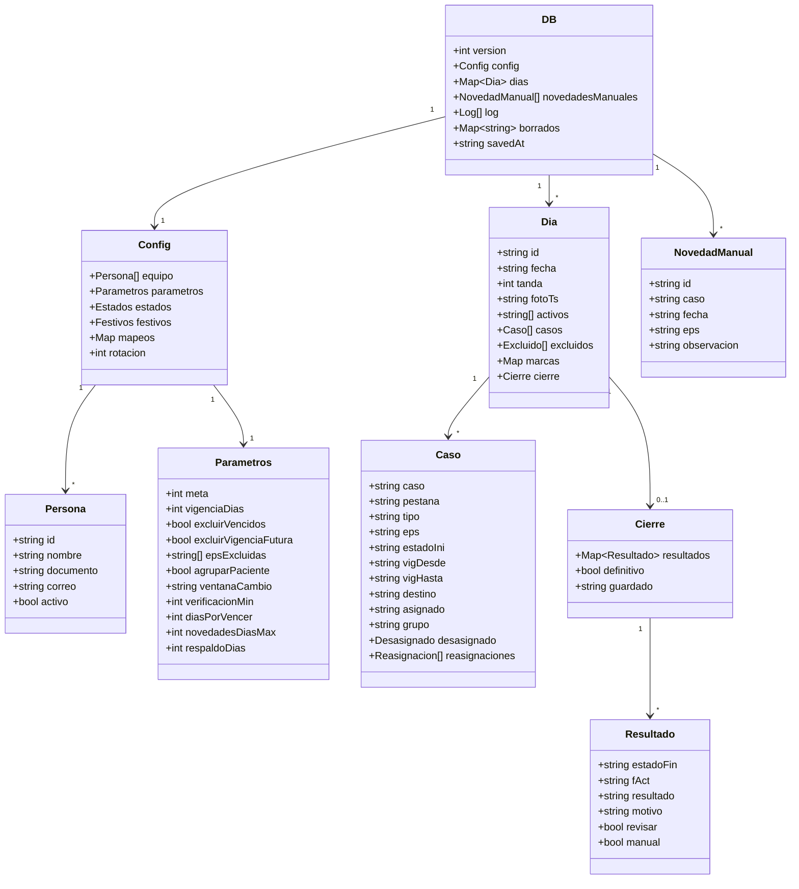
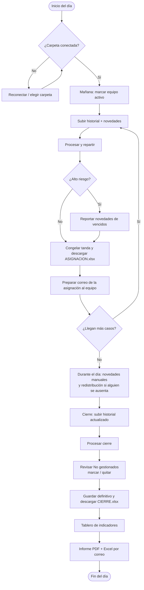
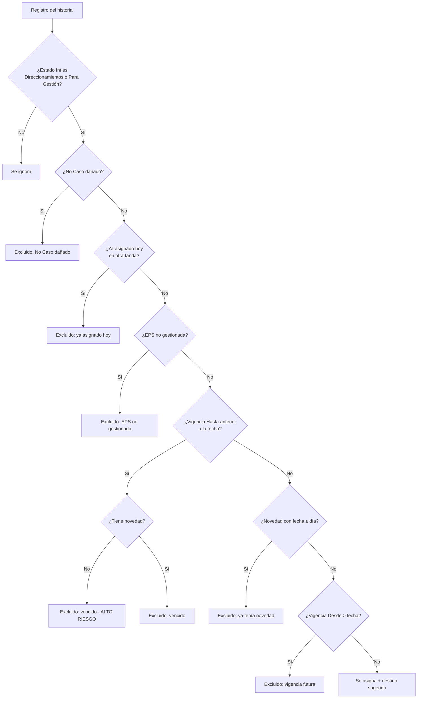
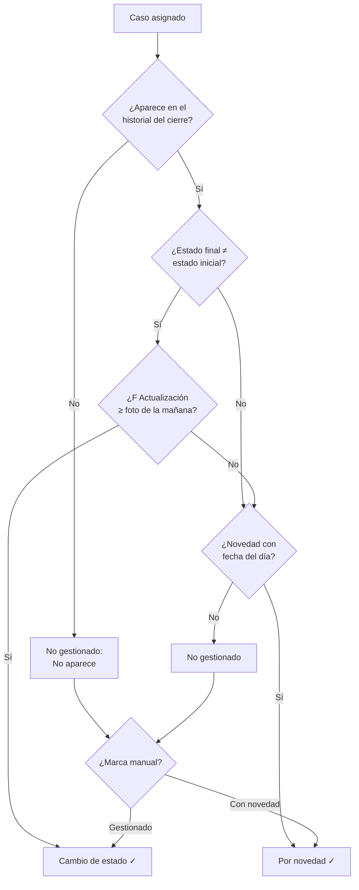
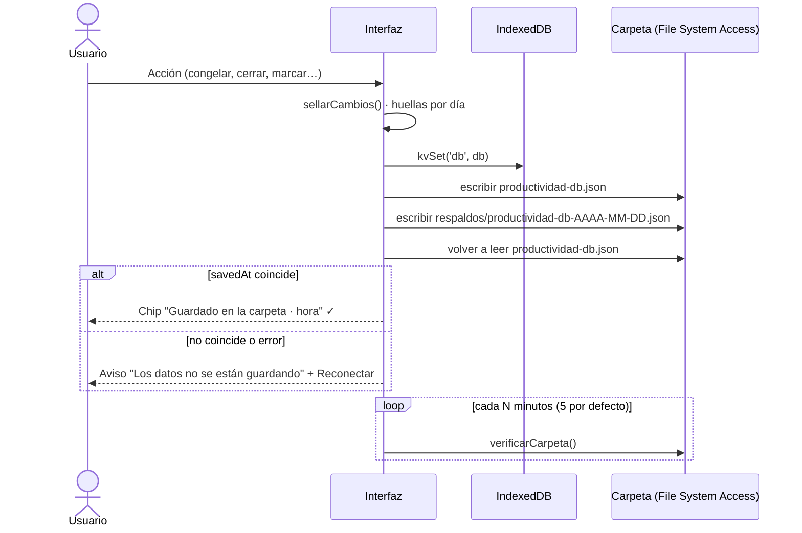
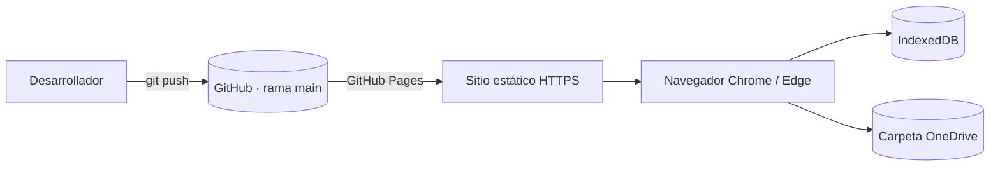

<p align="center"></p>

<h1 align="center">MEDIC-DORES</h1>
<p align="center"><b>Documento técnico del desarrollo de software</b><br>
Herramienta web para medir la productividad diaria de un equipo de cuentas médicas<br>
Proyecto de aplicación · Desarrollo de Software · Sexto semestre</p>

<p align="center">Autores: <b>Kevin Gomez</b> y <b>Alejandro Jauregui</b> · Versión del producto: 1.11 · Noviembre de 2026</p>

> **Nota de portafolio:** esta versión pública usa datos y nombres ficticios. MEDIFLOW es una plataforma inventada de donde sale el historial de casos, y EPS Aurora, EPS Boreal, EPS Cóndor y EPS Orión son aseguradoras inventadas. Ningún dato real de pacientes, empresas ni personas está incluido en el repositorio.

---

## Tabla de contenido

1. [Resumen](#1-resumen)
2. [Planteamiento del problema](#2-planteamiento-del-problema)
3. [Objetivos](#3-objetivos)
4. [Alcance y limitaciones](#4-alcance-y-limitaciones)
5. [Metodología de desarrollo](#5-metodología-de-desarrollo)
6. [Levantamiento de requerimientos](#6-levantamiento-de-requerimientos)
7. [Lenguajes, tecnologías y herramientas](#7-lenguajes-tecnologías-y-herramientas)
8. [Arquitectura del sistema](#8-arquitectura-del-sistema)
9. [Modelo de datos](#9-modelo-de-datos)
10. [Flujos del sistema](#10-flujos-del-sistema)
11. [Algoritmos principales](#11-algoritmos-principales)
12. [Diseño de la interfaz (UI/UX)](#12-diseño-de-la-interfaz-uiux)
13. [Seguridad y privacidad](#13-seguridad-y-privacidad)
14. [Pruebas](#14-pruebas)
15. [Despliegue](#15-despliegue)
16. [Estructura del repositorio](#16-estructura-del-repositorio)
17. [Historial de versiones](#17-historial-de-versiones)
18. [Lecciones aprendidas y trabajo futuro](#18-lecciones-aprendidas-y-trabajo-futuro)
19. [Referencias](#19-referencias)

---

## 1. Resumen

MEDIC-DORES es una **aplicación web de una sola página (SPA)** que automatiza el reparto diario de casos de un equipo de cuentas médicas y mide su cumplimiento. El sistema lee archivos de Excel (`.xlsx`) exportados de la plataforma de autorizaciones y depura los casos con reglas de negocio configurables. Después los reparte de forma equitativa entre las personas activas del día, prepara el correo de la asignación y, al cierre, compara el estado inicial con el estado final de cada caso. Con eso calcula el **porcentaje de cumplimiento** por persona y por equipo, y genera un informe en PDF y Excel para la jefatura.

La decisión técnica más importante fue construir la herramienta **sin servidor ni dependencias de red**. Todo corre en el navegador, los datos se guardan en IndexedDB y en una carpeta local elegida por el usuario, y la aplicación completa se distribuye como un único archivo `index.html`. Así se resolvieron tres restricciones del entorno real: no había presupuesto para infraestructura, no se tenían permisos para instalar software y los datos de salud no debían salir del equipo.

**Palabras clave:** JavaScript, SPA, offline-first, procesamiento de Excel en el navegador, IndexedDB, File System Access API, indicadores de productividad.

---

## 2. Planteamiento del problema

El equipo gestiona a diario cientos de casos de autorizaciones médicas que llegan en dos bandejas: **Direccionamientos** y **Para Gestión**. Antes de la herramienta el proceso era manual:

- Cada mañana se descargaba el historial, se filtraba a mano en Excel y se copiaban los casos a una hoja por persona.
- No había una regla única para excluir casos vencidos, con novedad ya reportada o de EPS que no se gestionan, así que el reparto variaba según quién lo hiciera.
- Al final del día se comparaba "a ojo" qué casos habían cambiado de estado, lo que tomaba tiempo y generaba diferencias en el indicador.
- No había histórico consolidado para ver la tendencia por semana o por mes ni para detectar casos vencidos sin novedad reportada, que son los de **alto riesgo**.

**Pregunta problema:** ¿cómo automatizar el reparto y la medición diaria de la gestión de casos de forma confiable, trazable y sin exponer datos sensibles, en un entorno sin servidor y sin permisos de instalación?

---

## 3. Objetivos

### 3.1 Objetivo general

Desarrollar una aplicación web offline que automatice la depuración, el reparto y la medición del cumplimiento diario de un equipo de cuentas médicas a partir de los archivos Excel que ya se usan en la operación.

### 3.2 Objetivos específicos

1. Levantar y documentar las reglas de negocio de depuración, reparto y cierre con el equipo usuario.
2. Implementar un lector y un escritor de archivos `.xlsx` que funcionen en el navegador sin servidor.
3. Diseñar un motor de reglas con **funciones puras** que se puedan probar de forma aislada.
4. Implementar un algoritmo de reparto equitativo que respete la regla de "mismo paciente, misma persona".
5. Garantizar la persistencia de los datos con verificación y respaldos automáticos.
6. Construir un tablero de indicadores con filtros por periodo, persona, pestaña, tipo de servicio y EPS, con informe en PDF y modo presentación.
7. Documentar el sistema con un manual de usuario integrado y este documento técnico.

---

## 4. Alcance y limitaciones

| Incluido en el alcance | Fuera del alcance |
|---|---|
| Lectura del historial y de los formatos de novedades en `.xlsx` | Conexión directa (API) con la plataforma de autorizaciones |
| Depuración, reparto por tandas y cierre diario | Gestión de los casos en sí (eso se hace en la plataforma) |
| Indicadores por día, semana, mes, rango y año | Autenticación de usuarios y roles |
| Exportación a Excel de asignación, cierre y tablero | Uso multiusuario simultáneo en tiempo real |
| Persistencia local con respaldos y unión de copias | Aplicación móvil |
| Manual de uso integrado | Soporte para Firefox o Safari en el guardado en carpeta |
| Correo de la asignación y del informe preparado (mailto, Gmail, Outlook web) | Envío automático del correo con adjuntos |
| Informe PDF propio, modo presentación y modo oscuro | Gráficas interactivas dentro del PDF |

**Limitaciones técnicas conocidas:**

- La **File System Access API** solo existe en navegadores basados en Chromium (Chrome y Edge). En otros navegadores la app funciona, pero guarda únicamente en el navegador.
- El navegador vuelve a pedir el permiso de la carpeta en cada sesión, porque es una política de seguridad del propio navegador.
- Como no hay servidor, la app **no puede enviar correos ni adjuntar archivos sola**: prepara el correo y la persona solo arrastra el archivo. Donde Windows lo permite, la *Web Share API* abre "Compartir" con el archivo ya adjunto.
- El lector de `.xlsx` es "mínimo": cubre lo que generan Excel y la plataforma, como texto compartido, números, fechas y hojas ocultas, pero no fórmulas complejas ni tablas dinámicas.

---

## 5. Metodología de desarrollo

### 5.1 Enfoque: ágil, iterativo e incremental

Usamos un enfoque **ágil iterativo e incremental**, inspirado en **Scrum** para organizar el trabajo en iteraciones cortas con entrega de valor y en **Kanban** para visualizar las tareas (pendiente → en progreso → hecho). No aplicamos Scrum "de libro", porque el equipo era de dos desarrolladores y el usuario final estaba en la misma área. Lo adaptamos así:

| Práctica ágil | Cómo la aplicamos |
|---|---|
| Product backlog | Lista priorizada de necesidades del equipo de cuentas médicas, escrita como historias de usuario. |
| Iteraciones (sprints) cortas | Cada iteración terminó en una **versión utilizable** (1.0 → 1.11). |
| Revisión con el usuario | Al final de cada versión el equipo usuario la probaba con datos reales del día. Sus observaciones entraban al backlog. |
| Retrospectiva | Después de cada versión revisábamos qué falló en la operación, por ejemplo la pérdida de datos del navegador, y lo convertíamos en un requisito no funcional. |
| Definición de terminado | Funciona con los archivos reales, no rompe los datos guardados (hay migración), queda en el registro de actividad y se explica en la ventana de novedades de la versión. |

### 5.2 Por qué no cascada

Los requisitos **cambiaron mucho durante el desarrollo**. Por ejemplo, el formato de las novedades cambió entre EPS y aparecieron necesidades nuevas como las "tandas" o la regla de "mismo paciente". Con cascada habríamos tenido que rehacer el diseño completo. El enfoque iterativo nos dejó entregar algo útil desde la primera versión y mejorarlo con la retroalimentación diaria.

### 5.3 Ciclo de cada iteración



### 5.4 Prácticas de ingeniería aplicadas

- **Separación de responsabilidades:** la lógica de negocio no toca el DOM.
- **Funciones puras** en el motor de reglas, para poder hacer pruebas unitarias en Node.js.
- **Migración de datos:** la función `migrate()` completa los campos nuevos de cada versión sin perder los días guardados.
- **Versionado semántico simple** (`APP_VERSION`) con una ventana de "Novedades de esta actualización".
- **Control de versiones con Git** y publicación en GitHub.
- **Registro de actividad (log)** para auditar quién hizo qué y cuándo dentro de la herramienta.

---

## 6. Levantamiento de requerimientos

### 6.1 Actores

| Actor | Descripción |
|---|---|
| Coordinador(a) / administrador(a) | Hace el reparto en la mañana, el cierre en la tarde y consulta el tablero. No hace parte del equipo medido. |
| Analista del equipo | Recibe su hoja de casos en Excel. Su cumplimiento es lo que se mide. |
| Plataforma MEDIFLOW (sistema externo) | Origen del historial de casos (`.xlsx`). |
| EPS (sistemas externos) | Origen de los formatos de novedades (`.xlsx`) o de reportes sin archivo. |

### 6.2 Requerimientos funcionales

| ID | Requerimiento |
|---|---|
| RF-01 | Registrar, editar y quitar personas del equipo y marcar quién trabaja cada día. |
| RF-02 | Leer el historial `.xlsx` y ubicar las columnas por **nombre de encabezado**, no por posición. |
| RF-03 | Leer uno o varios formatos de novedades por EPS, detectar la columna de caso y la de fecha, y recordar el mapeo cuando haya que preguntarlo. |
| RF-04 | Depurar los candidatos: EPS no gestionadas, vencidos, con novedad y con vigencia futura. |
| RF-05 | Alertar los casos vencidos sin novedad (alto riesgo). |
| RF-06 | Repartir de forma equitativa, agrupando los casos de un mismo paciente. |
| RF-07 | Permitir varias tandas por día sin repetir casos. |
| RF-08 | Congelar la asignación y exportar `ASIGNACION_dd-mm-aaaa.xlsx` con una hoja por persona. |
| RF-09 | Registrar novedades manuales. |
| RF-10 | Procesar el cierre comparando contra el historial actualizado y clasificar cada caso. |
| RF-11 | Marcar gestión manual, quitar casos de la asignación y reasignar, siempre con trazabilidad. |
| RF-12 | Guardar el cierre como provisional o definitivo, y reabrirlo. |
| RF-13 | Mostrar el tablero con filtros y exportarlo a Excel. |
| RF-14 | Buscar el recorrido completo de un número de caso. |
| RF-15 | Recuperar días desde los Excel descargados e importar el histórico anterior. |
| RF-16 | Calcular los festivos de Colombia y permitir ajustarlos. |
| RF-17 | Respaldar y restaurar (unir o reemplazar) toda la información. |
| RF-18 | Ofrecer un manual de uso dentro del sistema, con búsqueda e impresión. |
| RF-19 | Alertar los casos **por vencer** (hoy o dentro de N días hábiles) y ponerlos de primeros en la lista de cada persona. |
| RF-20 | Preparar el **correo de la asignación** con los correos del equipo, el asunto y un mensaje editable guardable como plantilla. |
| RF-21 | Generar un **informe en PDF y Excel** con los filtros del tablero, con conclusiones automáticas, y preparar su correo. |
| RF-22 | Mostrar el tablero en **modo presentación** (pantalla completa, actualización automática). |
| RF-23 | **Redistribuir** los casos pendientes de una persona que se ausenta a mitad del día. |
| RF-24 | Ofrecer **tema claro, oscuro y automático**. |
| RF-25 | Avisar cuando un archivo de novedades parece **desactualizado**. |

### 6.3 Requerimientos no funcionales

| ID | Tipo | Requerimiento |
|---|---|---|
| RNF-01 | Portabilidad | Funcionar abriendo un único archivo HTML, sin instalación ni servidor. |
| RNF-02 | Disponibilidad | Funcionar sin conexión a internet: fuentes, íconos y librerías van embebidos. |
| RNF-03 | Privacidad | Los datos no salen del equipo. No se guardan nombres ni documentos de pacientes, solo una huella (hash). |
| RNF-04 | Confiabilidad | Verificar cada guardado releyendo el archivo, hacer una copia diaria y unir las copias sin perder días. |
| RNF-05 | Rendimiento | Procesar historiales de miles de filas en pocos segundos en un equipo de oficina. |
| RNF-06 | Usabilidad | Mostrar una guía de pasos ("Siguiente paso"), mensajes claros y atajos de teclado (Ctrl + K). |
| RNF-07 | Mantenibilidad | Mantener la lógica de negocio en funciones puras con pruebas unitarias. |
| RNF-08 | Accesibilidad | Usar etiquetas en los campos, foco visible y respetar `prefers-reduced-motion`. |
| RNF-09 | Trazabilidad | Registrar cada acción relevante (congelar, cerrar, reasignar, quitar o marcar) con fecha y detalle. |
| RNF-10 | Mantenimiento de datos | Borrar solas las copias diarias antiguas (60 días por defecto), conservando una por mes. |

### 6.4 Historias de usuario (muestra)

> **HU-01 · Repartir los casos del día**
> *Como* coordinadora, *quiero* subir el historial y que la app reparta los casos de forma equitativa, *para* no hacerlo a mano en Excel.
> **Criterios de aceptación:** (1) solo se reparten casos en Direccionamientos o Para Gestión; (2) la diferencia entre la persona con más casos y la de menos es como máximo el tamaño del bloque más grande; (3) se descarga un Excel con una hoja por persona.

> **HU-02 · Mismo paciente, misma persona**
> *Como* analista, *quiero* recibir juntos todos los casos de un mismo paciente, *para* gestionarlos en una sola llamada.
> **Criterios de aceptación:** (1) los casos con el mismo tipo y número de documento van a la misma persona; (2) si el paciente ya tenía casos en una tanda anterior del día, los nuevos van con esa persona; (3) el documento del paciente no se guarda.

> **HU-03 · Medir el cierre**
> *Como* coordinadora, *quiero* subir el historial de la tarde y ver qué casos cambiaron de estado, *para* calcular el cumplimiento sin revisar caso por caso.
> **Criterios de aceptación:** (1) solo cuentan los cambios posteriores a la foto de la mañana; (2) una novedad con fecha del día cuenta como gestión; (3) puedo corregir con una marca manual que queda registrada.

> **HU-04 · No perder información**
> *Como* coordinadora, *quiero* que los datos se guarden en una carpeta de OneDrive, *para* no perder el histórico si se borra el navegador o cambio de equipo.
> **Criterios de aceptación:** (1) sin carpeta no se puede asignar ni cerrar; (2) cada guardado se verifica; (3) al conectar una carpeta con datos se unen sin perder días.

### 6.5 Diagrama de casos de uso



---

## 7. Lenguajes, tecnologías y herramientas

### 7.1 Lenguajes

| Lenguaje | Uso en el proyecto |
|---|---|
| **HTML5** | Estructura de la SPA, plantillas generadas desde JavaScript con *template literals*. |
| **CSS3** | Variables CSS (`--navy`, `--teal`…) para el tema, Flexbox y CSS Grid para el layout, animaciones, `@media print` para imprimir el manual y `prefers-reduced-motion`. |
| **JavaScript (ES2017+)** | Todo el comportamiento: `async/await`, `Map`/`Set`, desestructuración, *arrow functions*, módulos con patrón IIFE/UMD. Es **JavaScript puro** (*vanilla*), sin frameworks. |
| **PDF 1.4 (operadores de página)** | El informe se escribe directamente en formato PDF: texto Helvetica, rectángulos, líneas y arcos vectoriales. |
| **XML (OOXML / SpreadsheetML)** | Formato interno de los `.xlsx` (ECMA-376). Lo leemos y escribimos directamente. |
| **JSON** | Formato de la base de datos (`productividad-db.json`) y de los respaldos. |
| **SVG** | Logo e íconos de línea dibujados a mano, sin librería de íconos. |

### 7.2 APIs del navegador

| API | Para qué |
|---|---|
| **IndexedDB** | Guardar la base de datos y el *handle* de la carpeta en el navegador. |
| **File System Access API** (`showDirectoryPicker`, `FileSystemFileHandle.createWritable`) | Leer y escribir `productividad-db.json` y la carpeta `respaldos/` en una carpeta local u OneDrive. |
| **File API / Blob / URL.createObjectURL** | Leer los Excel subidos y descargar los Excel generados. |
| **Web Share API** (`navigator.share`, `canShare`) | Botón "Compartir…" con el Excel o el informe ya adjuntos, donde el sistema lo permite. |
| **Enlaces `mailto:` / Gmail / Outlook web** | Abrir el correo de la asignación o del informe ya redactado. |
| **Fullscreen API** (`requestFullscreen`) | Modo presentación del tablero. |
| **`matchMedia('(prefers-color-scheme: dark)')`** | Tema automático según la configuración de Windows. |
| **localStorage** | Preferencias pequeñas, como el menú contraído o la ventana de novedades ya vista. |
| **TreeWalker (DOM)** | Resaltar las coincidencias del buscador del manual. |
| **requestAnimationFrame** | Animar los contadores del tablero. |

### 7.3 Librería externa

| Librería | Versión | Licencia | Uso |
|---|---|---|---|
| **JSZip** | 3.10.1 | MIT / GPLv3 (dual) | Descomprimir y comprimir los `.xlsx`, que son archivos ZIP. Va **embebida** en el HTML para funcionar offline. |

Todo lo demás es código propio: el lector y escritor de Excel (`XLSXLite`), el motor de reglas (`Logic`), los reportes (`Reports`), el **generador de PDF (`MiniPDF`)**, el **informe (`Informe`)**, las gráficas en SVG y la interfaz.

### 7.4 Herramientas de desarrollo

- **Git y GitHub** para el control de versiones, y **GitHub Pages** para publicar.
- **Google Chrome DevTools** para depurar e inspeccionar IndexedDB.
- **Node.js** para ejecutar las pruebas unitarias del motor de reglas (`tests/logic.test.js`).
- **Playwright** (navegador automatizado) para verificar que la interfaz carga y que el manual funciona.
- **Microsoft Excel** para validar que los archivos generados abren correctamente.

### 7.5 ¿Por qué JavaScript puro y no React o Angular?

1. **Restricción de despliegue:** la app tenía que ser un único archivo que se abre con doble clic. Un framework con *build* (webpack o Vite) agregaba un paso de compilación que el área no podía mantener.
2. **Tamaño y simplicidad:** la interfaz se re-dibuja por módulo con `render()`, un patrón simple y suficiente para este volumen.
3. **Aprendizaje:** nos obligó a entender bien el DOM, los eventos y el manejo de estado sin "magia" del framework.

---

## 8. Arquitectura del sistema

### 8.1 Estilo arquitectónico

Es una **arquitectura en capas dentro de una SPA cliente**, con un enfoque **offline-first**. Cada capa es un módulo autocontenido (IIFE) que se publica en `window` y, cuando corre en Node, también en `module.exports`:



### 8.2 Componentes del archivo `index.html`

| Bloque | Tamaño aprox. | Responsabilidad |
|---|---|---|
| `<style>` | ≈680 líneas | Tema visual claro y oscuro, layout y componentes (tarjetas, tablas, chips, paleta, informe, presentación, manual). |
| `<script>` JSZip | 95 KB (minificado) | Manejo de ZIP. |
| `<script>` XLSXLite | ≈270 líneas | `readWorkbook()`: lee *sharedStrings*, estilos (para detectar fechas), hojas y estado visible u oculto. `writeWorkbook()`: genera `.xlsx` con estilos, anchos y colores. |
| `<script>` Logic | ≈830 líneas | Reglas de negocio puras: fechas, festivos, lectura del historial, novedades, depuración, reparto, por vencer, redistribución, cierre, tandas, indicadores y periodos. |
| `<script>` Reports | ≈300 líneas | Transforma los datos del dominio en hojas de Excel y en los datos del tablero. |
| `<script>` MiniPDF | ≈120 líneas | Generador de PDF vectorial sin librerías: texto Helvetica (con tildes y ñ), rectángulos, líneas y arcos. |
| `<script>` Informe | ≈230 líneas | Conclusiones automáticas en lenguaje claro, armado del PDF del informe y cuerpo del correo. |
| `<script>` UI | ≈1.960 líneas | Vistas, eventos, persistencia, verificación de la carpeta, paleta de comandos, tema, presentación, correos y manual. |

### 8.3 Decisiones de arquitectura (ADR resumidos)

| # | Decisión | Alternativas | Motivo |
|---|---|---|---|
| ADR-1 | Sin backend: todo en el navegador | API en Node/Python con base de datos | Sin presupuesto ni permisos de servidor, y datos sensibles que no deben salir del equipo. |
| ADR-2 | Un solo archivo HTML con todo embebido | Varios archivos + CDN | Funciona offline y se "instala" copiando un archivo. |
| ADR-3 | Lector de `.xlsx` propio sobre JSZip | SheetJS (librería grande) | Menos peso, control total y no depender de licencias cambiantes. |
| ADR-4 | Doble persistencia: IndexedDB + carpeta | Solo localStorage | localStorage tiene poco espacio y se borra con la limpieza del navegador. La carpeta en OneDrive da respaldo real. |
| ADR-5 | Columnas por **nombre** de encabezado | Por letra de columna | La plataforma cambia el orden de las columnas entre descargas. |
| ADR-7 | Generador de PDF propio | jsPDF o imprimir la página | Mantener el archivo único sin otra librería grande y controlar el diseño del informe. |
| ADR-8 | Correo preparado (mailto / web) en vez de envío directo | Servidor SMTP o API de correo | No hay servidor. Así la persona revisa y envía desde su propio correo. |
| ADR-6 | Lógica en funciones puras | Lógica mezclada con la UI | Se puede probar sin navegador y se pueden cambiar reglas con menos riesgo. |

---

## 9. Modelo de datos

La base de datos es un **documento JSON** (estilo NoSQL documental) que se guarda completo en IndexedDB (clave `db`) y en `productividad-db.json`.



**Decisiones del modelo:**

- La clave de cada día es `fecha` en la primera tanda y `fecha#n` en las siguientes, para soportar varias tandas sin cambiar la estructura.
- `grupo` guarda una **huella** del paciente (ver 11.6), nunca el documento.
- `borrados` funciona como "lápida" (*tombstone*): registra lo que se eliminó a propósito para que, al unir copias, no "reviva".
- Los resultados posibles se centralizan en la constante `RES`: *Cambio de estado*, *Por novedad*, *No gestionado* y *Quitado de la asignación*. *Adicional* y *Por externo* quedan reservados para compatibilidad.

---

## 10. Flujos del sistema

### 10.1 Flujo general del día



### 10.2 Flujo de depuración de la mañana (`planMorning`)



### 10.3 Flujo del cierre (`computeClose`)



### 10.4 Secuencia de guardado verificado



---

## 11. Algoritmos principales

### 11.1 Lectura de Excel en el navegador

Un `.xlsx` es un ZIP con archivos XML. `XLSXLite.readWorkbook()`:

1. Descomprime con JSZip.
2. Lee `xl/workbook.xml` para obtener los nombres de las hojas y su estado (visible u oculta), y las relaciones `_rels`.
3. Lee `xl/sharedStrings.xml`, el diccionario de textos repetidos.
4. Lee `xl/styles.xml` para saber qué formatos numéricos son **fechas**, incluidos los formatos personalizados.
5. Recorre cada `<c r="B2" t="s" s="3"><v>…</v></c>` y convierte la referencia (`B2` → columna 1) con `colToIndex()`. Resuelve el texto compartido y convierte los seriales de fecha de Excel a ISO con `(n − 25569) × 86 400 000` ms.

El escritor hace el proceso inverso y genera estilos para los encabezados y para los colores de Cumple/No cumple.

### 11.2 Detección de columnas por encabezado

Para tolerar los cambios de formato, los encabezados se **normalizan**: sin tildes (`normalize('NFD')`), en minúsculas y sin signos. Así *"Última Actualización."* y *"ultima actualizacion"* son iguales. Se buscan en las primeras 15 filas. En las novedades, además se valida que la columna candidata **parezca de números de caso** (al menos el 50 % de los valores con 20 o más caracteres y 15 o más dígitos).

### 11.3 Reparto equitativo con bloques

Es una variante **voraz (greedy)** del problema de balanceo de carga, cercana a la heurística **LPT** (*Longest Processing Time first*):

```
bloques ← agrupar casos por huella de paciente (o 1 caso = 1 bloque)
ordenar bloques por: tamaño desc, Direccionamientos primero, vigencia más próxima
para cada bloque:
    si el paciente ya tenía dueño hoy → asignar a ese dueño
    si no → asignar a la persona con menor (total, casos en la pestaña, turno)
turno ← rota cada día (config.rotacion) para que los empates no favorezcan siempre a la misma persona
```

**Complejidad:** O(B · P), con B = número de bloques y P = personas activas. En la práctica (≈1.000 casos y 5 personas) tarda milisegundos.

### 11.3.1 Casos por vencer

Para cada caso asignado se cuentan los **días hábiles** (sin fines de semana ni festivos) entre la fecha de asignación y su *Vigencia Hasta*. Si el resultado está entre 0 y `diasPorVencer` (2 por defecto), el caso se marca como "VENCE HOY" o "Vence en N días hábiles". En el Excel va de primero en la hoja de la persona y se resalta en rojo.

### 11.3.2 Redistribución por ausencia (`redistribuir`)

1. Toma los casos de la persona ausente en las tandas **sin cierre definitivo**.
2. Si se sube un historial reciente, **deja** con ella los que ya cambiaron de estado o tienen marca manual, y **mueve** el resto.
3. Reparte los que se mueven con la misma heurística voraz (11.3), respetando "mismo paciente, misma persona".
4. Registra cada caso como **reasignación** con el motivo y la observación, y genera `ASIGNACION_…_REDISTRIBUIDA.xlsx`.

### 11.4 Cálculo del indicador

```
base         = asignados − quitados
gestionados  = cambio de estado + por novedad (incluye marcas manuales)
% cumplimiento = gestionados / base × 100
cumple       = % ≥ meta (80 por defecto)
```

Se calcula por persona, por persona-día (para contar los "días que cumplió") y por equipo. `aggregate()` recorre los registros una sola vez: O(n).

### 11.5 Festivos de Colombia

- **Domingo de Pascua** con el algoritmo de *Meeus/Jones/Butcher* (calendario gregoriano).
- Los festivos móviles se calculan desde Pascua: Jueves y Viernes Santo, Ascensión (+39 días), Corpus Christi (+60) y Sagrado Corazón (+68).
- **Ley Emiliani (Ley 51 de 1983):** varios festivos se trasladan al lunes siguiente (`nextMonday`).
- El usuario puede quitar festivos o agregar días no hábiles internos.

### 11.6 Huella del paciente (privacidad)

Para agrupar los casos sin guardar el documento, se calcula una **doble huella FNV-1a de 32 bits** sobre `tipo:documento` normalizado y se concatena en base 36 (`p` + h1 + h2). No es un cifrado. Es un identificador que no permite leer el documento a simple vista y que sirve para comparar igualdad.

### 11.6.1 Generación del PDF (`MiniPDF` + `Informe`)

Un PDF es texto estructurado: objetos numerados (catálogo, páginas, fuentes y contenidos), una tabla de referencias cruzadas (`xref`) con la posición en bytes de cada objeto, y un `trailer`. `MiniPDF` escribe esos objetos a mano y dibuja con los operadores de página (`re` para rectángulos, `l` para líneas, curvas de Bézier para los arcos del medidor, y `BT … Tj … ET` para el texto en Helvetica con codificación WinAnsi, que admite tildes y ñ). `Informe.conclusiones()` redacta frases según los datos: cumplimiento frente a la meta y al periodo anterior, mejor resultado y personas que requieren seguimiento.

### 11.7 Unión de copias sin pérdida (`unirDb`)

Es una estrategia de **"gana la escritura más reciente" por registro** (*last-writer-wins* por día), con lápidas:

1. Se toma como base la copia con `savedAt` más reciente.
2. Se agregan los días que solo existen en la otra copia.
3. Si un día existe en ambas, gana la versión con el `modificado` más reciente, que se calcula con huellas de contenido.
4. Los días en `borrados`, con lápida posterior a su última modificación, no se restauran.
5. Las novedades manuales, el log y el equipo se unen sin duplicar.

Antes de sobrescribir la carpeta se guarda una copia en `respaldos/carpeta-antes-de-…json`. Las copias diarias se depuran solas después de `respaldoDias` (60 por defecto), conservando siempre una por mes; las previas a una unión se conservan 30 días.

---

## 12. Diseño de la interfaz (UI/UX)

- **Tema claro, oscuro y automático:** se implementó con el atributo `data-theme` en `<html>` y variables CSS que cambian de valor, sin duplicar estilos. El modo automático sigue `prefers-color-scheme`.
- **Modo presentación:** el tablero en pantalla completa, que se actualiza solo cada 2 minutos.
- **Paleta:** azul marino `#23476b` (confianza, tema institucional) y turquesa `#54ffdd` / `#0f9f8a` (acento de salud). Verde, rojo y naranja solo para estados.
- **Tipografía:** *Inter* para el texto y los números tabulares, que alinean las cifras en las tablas, y *Poppins* para la marca. Ambas van embebidas en base64.
- **Logo MEDIC-DORES:** un **medidor** (gauge) con una **cruz médica** en el centro y una línea de pulso. Representa "medir" la gestión médica, y el nombre juega con *medic* + *medidores*.
- **Patrones de UX:** guía de pasos con "Siguiente paso", tarjetas KPI con íconos, estados vacíos explicativos, confirmaciones antes de acciones destructivas, *toasts* no intrusivos, paleta de comandos (Ctrl + K) y menú lateral contraíble.
- **Accesibilidad:** `label for` en los campos, `aria-label` en la navegación, foco visible y animaciones que se desactivan con `prefers-reduced-motion`.
- **Diseño adaptable:** a menos de 900 px el índice del manual pasa arriba y se ocultan los elementos secundarios.

---

## 13. Seguridad y privacidad

| Riesgo | Control implementado |
|---|---|
| Fuga de datos de salud | No hay servidor ni llamadas de red: los archivos se procesan en memoria y en el equipo local. |
| Datos personales de pacientes | No se guardan nombres ni documentos, solo una huella (11.6). El historial crudo no se almacena: solo se guardan los campos mínimos. |
| Inyección de HTML/JS (XSS) desde Excel | Todo texto que viene de archivos pasa por `esc()` antes de insertarse en el DOM. |
| Pérdida de datos | Guardado doble, verificación por relectura, copia diaria, respaldo manual `.json`, recuperación desde los Excel y unión sin pérdida. |
| Escritura accidental en la carpeta | El permiso de la File System Access API lo concede el usuario y se limita a la carpeta elegida. |
| Correos con datos | El correo solo lleva un mensaje corto. Los datos van en el Excel o PDF que la persona adjunta conscientemente. |
| Cambios no auditados | Registro de actividad (hasta 3.000 eventos) y marcas manuales con fecha, hora y observación. |

Este enfoque de **privacidad desde el diseño** está alineado con los principios de la ley colombiana de protección de datos personales (Ley 1581 de 2012): finalidad, mínimo dato necesario y seguridad.

---

## 14. Pruebas

### 14.1 Estrategia

| Nivel | Qué se prueba | Cómo |
|---|---|---|
| Unitarias | Motor de reglas `Logic` (funciones puras) | `node tests/logic.test.js` (Node.js + `assert`, sin dependencias) |
| Integración | Lectura de Excel reales, exportes y unión de copias | Pruebas manuales con archivos del día. `window.__pmPruebas` expone `unirDb` para probar desde la consola |
| Interfaz (humo) | Que la app cargue, navegue y que el manual busque y salte entre secciones | Navegador automatizado (Playwright + Chrome) |
| Aceptación | Historias de usuario con el equipo | Uso real durante cada iteración |

### 14.2 Pruebas unitarias incluidas (21 casos, todos aprobados)

```
$ node tests/logic.test.js

Fechas y festivos
  ✓ Domingo de Pascua 2026 = 5 de abril
  ✓ Colombia tiene 18 festivos en 2026
  ✓ Reyes Magos 2026 se corre al lunes 12 de enero (Ley Emiliani)
  ✓ Sábado, domingo y festivo no son días hábiles
  ✓ parseDate acepta dd/mm/aaaa con a. m./p. m., ISO, dd-MMM-aa y serial de Excel
Número de caso
  ✓ Detecta un No Caso dañado por Excel (notación científica)
  ✓ Limpia apóstrofo, espacios y ".0"
Lectura del historial
  ✓ Ubica columnas por encabezado y clasifica PBS / NO PBS
  ✓ Falla con mensaje claro si faltan columnas obligatorias
Mañana: depuración y reparto
  ✓ Aplica cada regla de exclusión con su motivo
  ✓ Destino sugerido: Gestión Posterior si la vigencia supera los días configurados
  ✓ Reparto equitativo: 10 casos entre 2 personas quedan 5 y 5
  ✓ Los casos de un mismo paciente van a la misma persona
  ✓ Alerta "por vencer": vence hoy (0) y en 2 días hábiles; no marca los lejanos
  ✓ Pasa los pendientes de la persona ausente y le deja los que ya gestionó
  ✓ Sin personas que reciban, no mueve nada y explica el error
Cierre e indicador
  ✓ Clasifica cambio de estado, novedad del día, sin cambio y no aparece
  ✓ Un cambio anterior a la foto de la mañana no cuenta
  ✓ Un caso quitado de la asignación no cuenta en la base del indicador
  ✓ Marca manual "Gestionado" convierte un No gestionado y se puede deshacer
Informe
  ✓ Genera un PDF válido con texto en español y figuras

21 pruebas correctas, 0 fallidas.
```

### 14.3 Casos de prueba funcionales (muestra)

| ID | Caso | Pasos | Resultado esperado |
|---|---|---|---|
| CP-01 | Asignar sin carpeta | Abrir Mañana sin carpeta conectada | Bloqueo con botón "Elegir carpeta" |
| CP-02 | Historial con columnas en otro orden | Subir un historial con las columnas movidas | Se lee bien (detección por encabezado) |
| CP-03 | No Caso en notación científica | Subir un archivo guardado en Excel | Se marca como "dañado" y se excluye con aviso |
| CP-04 | Segunda tanda | Congelar la tanda 1 y procesar otro historial | La tanda 2 no repite casos de la tanda 1 |
| CP-05 | Reabrir un cierre definitivo | Presionar Reabrir | Deja de contar en el tablero hasta marcarlo definitivo |
| CP-06 | Unión de copias | Conectar una carpeta con días que no están en el navegador | Resultado = unión de ambos; respaldo previo en `respaldos/` |
| CP-08 | Correo de la asignación | Congelar una tanda con personas que tienen correo | Se abre la ventana con Para, asunto y mensaje con el número de tanda |
| CP-09 | Informe PDF | Tablero → Generar informe → Descargar | Se descargan `Informe_productividad_<periodo>.pdf` y `.xlsx` con los filtros aplicados |
| CP-10 | Redistribución | Elegir persona ausente y receptores | Los pendientes pasan a otros y quedan como reasignación con motivo |
| CP-11 | Modo oscuro | Cambiar el tema con el botón de la barra superior | Toda la interfaz cambia y la preferencia se recuerda |
| CP-07 | Búsqueda en el manual | Escribir "tanda" | Solo quedan las secciones que lo mencionan y las palabras quedan resaltadas |

---

## 15. Despliegue

Al ser un sitio **estático**, se publica en **GitHub Pages** sin configuración adicional:

1. Subir `index.html` a la raíz de la rama `main`.
2. *Settings → Pages → Deploy from a branch → main / (root)*.
3. La app queda en `https://<usuario>.github.io/<repositorio>/`.

También se puede usar sin internet copiando `index.html` a cualquier equipo y abriéndolo con Chrome o Edge.



---

## 16. Estructura del repositorio

```
medic-dores/
├── index.html                 ← la aplicación completa (HTML + CSS + JS + JSZip)
├── logo.svg                   ← logo de MEDIC-DORES
├── README.md                  ← presentación del proyecto
├── MANUAL_DE_USO.txt          ← manual de usuario en texto plano
├── DOCUMENTACION_TECNICA.md   ← este documento
├── tests/
│   └── logic.test.js          ← pruebas unitarias del motor de reglas (Node.js)
└── docs/
    └── capturas/              ← capturas de pantalla (claro y oscuro) para el README
```

---

## 17. Historial de versiones

| Versión | Entregable principal |
|---|---|
| 1.0 – 1.3 | Primeras iteraciones: lectura del historial, depuración, reparto, cierre y tablero básico. |
| 1.4 – 1.5 | Tema visual empresarial: barra superior con nombre y versión, tarjetas con borde fino. |
| 1.6 | Interfaz clara y ligera, tablero dinámico, mejoras de carga y guardado. |
| 1.7 | Tipografía Inter con números tabulares, buscador **Ctrl + K**, menú contraíble, mini gráficas y micro-interacciones. |
| 1.8 | **Guía de pasos**, **marcar gestión manual** en el cierre y regla de **mismo paciente, misma persona**. |
| 1.9 | Alerta **por vencer**, **informe en PDF y Excel**, **modo presentación** y **modo oscuro**. |
| 1.10 | **Correo de la asignación** al equipo, correo de cada persona y mensaje guardable como plantilla. |
| 1.11 | Nueva identidad **MEDIC-DORES** (nombre y logo), **manual de uso integrado** con buscador e impresión, versión de portafolio con datos ficticios y pruebas unitarias. |

---

## 18. Lecciones aprendidas y trabajo futuro

### Lecciones aprendidas

- **Los datos de entrada cambian:** depender de la posición de las columnas fue un error temprano. Detectar por nombre hizo la app mucho más robusta.
- **El navegador no es un lugar seguro para guardar:** después de perder información por la limpieza del navegador, agregamos la carpeta, la verificación y la unión de copias. Fue la mejora con más impacto.
- **Separar la lógica de la interfaz** facilitó cambiar reglas sin miedo y escribir pruebas.
- **Hablar con el usuario cada iteración** reveló reglas que no estaban escritas en ningún lado, como las tandas, el mismo paciente o el alto riesgo.
- **Excel daña los números largos** (notación científica): había que tratar el No Caso siempre como texto.

### Trabajo futuro

1. Separar `index.html` en módulos ES (`/src`) con un paso de *build* que vuelva a producir un solo archivo.
2. Agregar pruebas de interfaz automatizadas en un *pipeline* de **GitHub Actions**.
3. Enviar el correo directamente con una API (por ejemplo Microsoft Graph) cuando haya autorización de la empresa.
4. Convertirla en **PWA** (Service Worker + manifest) para instalarla como aplicación.
5. Conexión opcional con la API de la plataforma, para no descargar archivos a mano.
6. Datos de demostración precargados para probar el tablero sin archivos reales.

---

## 19. Referencias

- MDN Web Docs. *IndexedDB API*. https://developer.mozilla.org/es/docs/Web/API/IndexedDB_API
- MDN Web Docs. *File System API*. https://developer.mozilla.org/en-US/docs/Web/API/File_System_API
- Ecma International. *ECMA-376 Office Open XML File Formats*.
- JSZip. *Documentación oficial*. https://stuk.github.io/jszip/
- Adobe. *PDF Reference, version 1.4* (estructura de objetos, xref y operadores de página).
- MDN Web Docs. *Web Share API*. https://developer.mozilla.org/en-US/docs/Web/API/Web_Share_API
- Congreso de Colombia. *Ley 51 de 1983* (traslado de festivos, "Ley Emiliani").
- Congreso de Colombia. *Ley 1581 de 2012* (protección de datos personales).
- Schwaber, K. y Sutherland, J. *La Guía de Scrum*. https://scrumguides.org
- Graham, R. L. (1969). *Bounds on multiprocessing timing anomalies* (heurística LPT de balanceo de carga).

---

<p align="center"><sub>MEDIC-DORES · Proyecto académico y de portafolio · Datos ficticios</sub></p>
