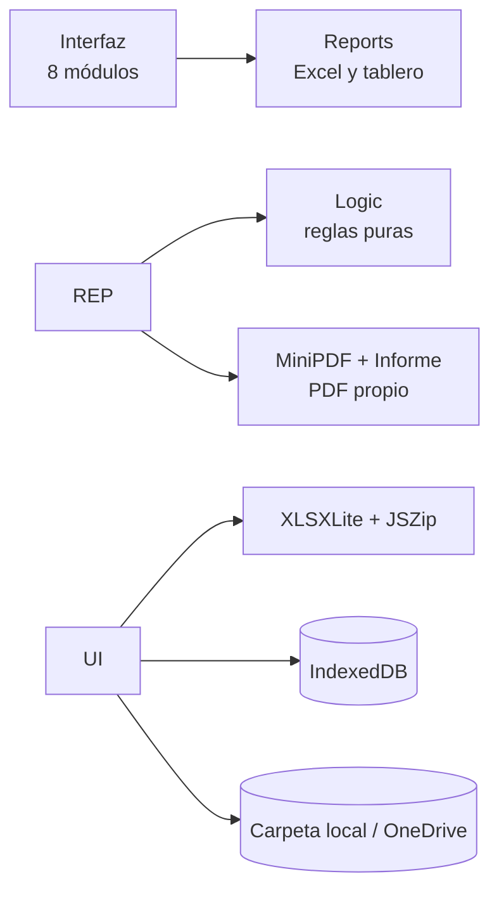

<p align="center">
  
</p>

<h1 align="center">MEDIC-DORES</h1>

<p align="center">
  <b>Herramienta web para repartir y medir la gestión diaria de un equipo de cuentas médicas.</b><br>
  Sin servidor · Funciona sin internet · Los datos nunca salen del equipo
</p>

<p align="center">
  
  
  
  
  
</p>

<p align="center">
  <a href="https://davidjaurmer-cell.github.io/medic-dores/"><b>▶ Ver la aplicación en vivo</b></a> ·
  <a href="MANUAL\_DE\_USO.txt">Manual de uso</a> ·
  <a href="DOCUMENTACION\_TECNICA.md">Documentación técnica</a>
</p>

\---

## 📌 ¿Qué es?

**MEDIC-DORES** automatiza el trabajo diario de un equipo que gestiona casos de autorizaciones médicas en dos bandejas, *Direccionamientos* y *Para Gestión*:

1. **En la mañana** lee el historial en Excel, **depura** los casos que no se deben asignar (EPS no gestionadas, vencidos, con novedad ya reportada o con vigencia futura) y los **reparte de forma equitativa** entre quienes trabajan ese día. Los casos de un mismo paciente quedan juntos.
Después prepara el **correo de la asignación** para el equipo.
2. **En la tarde** compara contra el historial actualizado y calcula el **porcentaje de cumplimiento** de cada persona.
3. **En el tablero** muestra indicadores por día, semana, mes, rango o año, con ranking, tendencia, calendario y análisis por EPS. Además genera un **informe en PDF y Excel** y tiene **modo presentación** para reuniones.

Todo corre en el navegador: el archivo `index.html` contiene la aplicación completa.

> ⚠️ \*\*Versión de portafolio:\*\* todos los nombres de EPS, plataformas y números de caso son \*\*ficticios\*\* (MEDIFLOW, EPS Aurora, EPS Boreal, EPS Cóndor y EPS Orión).

## 🖼️ Capturas

|Inicio|Manual de uso integrado|
|-|-|
|!\[Inicio](docs/capturas/inicio.png)|!\[Manual](docs/capturas/manual.png)|

|Modo oscuro|Configuración|
|-|-|
|!\[Modo oscuro](docs/capturas/modo-oscuro.png)|!\[Configuración](docs/capturas/configuracion.png)|

|Paleta de comandos (Ctrl + K)|
|-|
|!\[Paleta](docs/capturas/paleta-comandos.png)|

## ✨ Funcionalidades

* 📥 Lectura de archivos **.xlsx en el navegador**, con un lector propio sobre JSZip.
* 🧹 **Depuración automática**, paso a paso y con el motivo de cada exclusión.
* ⚠️ Alerta de **alto riesgo** (vencidos sin novedad) y de casos **por vencer**.
* ⚖️ **Reparto equitativo** con la regla *mismo paciente, misma persona* y varias **tandas** por día.
* ✉️ **Correo de la asignación** listo para enviar al equipo, con plantilla editable.
* 🔁 **Redistribución por ausencia** de los casos pendientes de una persona.
* ✅ **Cierre del día** con marcas manuales, casos quitados y reasignaciones, todo con trazabilidad.
* 📊 **Tablero** con filtros por persona, pestaña, PBS / NO PBS, EPS y resultado, exportable a Excel.
* 📄 **Informe en PDF y Excel** con conclusiones automáticas, generado con un motor de PDF propio.
* 🖥️ **Modo presentación** y 🌙 **modo oscuro**.
* 🔎 **Búsqueda del recorrido** completo de un caso.
* 💾 Guardado **doble y verificado** (IndexedDB + carpeta local u OneDrive), con respaldos diarios y unión de copias sin pérdida.
* 📅 **Festivos de Colombia** calculados con la Ley Emiliani.
* 📖 **Manual de uso integrado**, con índice, buscador con resaltado e impresión a PDF.
* ⌨️ Paleta de comandos **Ctrl + K**.

## 🚀 Cómo usarla

**Opción 1 (en línea):** abre el enlace de GitHub Pages en **Google Chrome** o **Microsoft Edge**.

**Opción 2 (local, sin internet):** descarga `index.html` y ábrelo con doble clic en Chrome o Edge.

Después ve a **Configuración**, elige una carpeta de datos, registra al equipo y sigue el módulo **Manual de uso**.

## 🧪 Pruebas

El motor de reglas es un conjunto de funciones puras y se prueba con Node.js, sin instalar dependencias:

```bash
node tests/logic.test.js
# 21 pruebas correctas, 0 fallidas.
```

## 🏗️ Arquitectura en una imagen



Los detalles de la metodología, los requerimientos, el modelo de datos, los flujos y los algoritmos están en [**DOCUMENTACION\_TECNICA.md**](DOCUMENTACION_TECNICA.md).

## 🛠️ Tecnologías

|Área|Tecnología|
|-|-|
|Lenguajes|HTML5, CSS3, JavaScript (ES2017+, sin frameworks)|
|Archivos|Office Open XML (.xlsx) con JSZip 3.10.1 y PDF generado con código propio|
|Persistencia|IndexedDB y File System Access API|
|Pruebas|Node.js (`assert`) y Playwright para pruebas de humo de la interfaz|
|Despliegue|GitHub Pages (sitio estático)|
|Metodología|Ágil iterativa e incremental (Scrum + Kanban adaptados)|

## 📁 Estructura

```
├── index.html                 Aplicación completa
├── logo.svg                   Logo
├── MANUAL\_DE\_USO.txt          Manual de usuario
├── DOCUMENTACION\_TECNICA.md   Documento técnico del desarrollo
├── tests/logic.test.js        Pruebas unitarias
└── docs/capturas/             Capturas de pantalla
```

## 👥 Autores

Desarrollado por **Kevin Gomez** y **Alejandro Jauregui**.

\---

<p align="center"><sub>Proyecto académico y de portafolio · Datos ficticios · 2026</sub></p>

